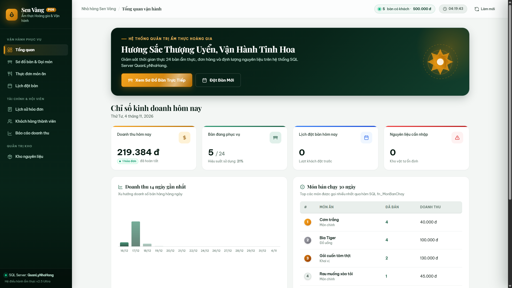
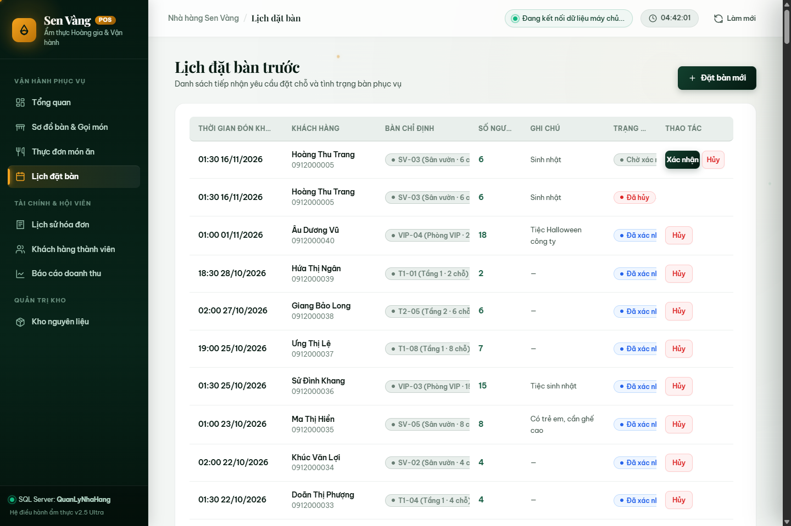
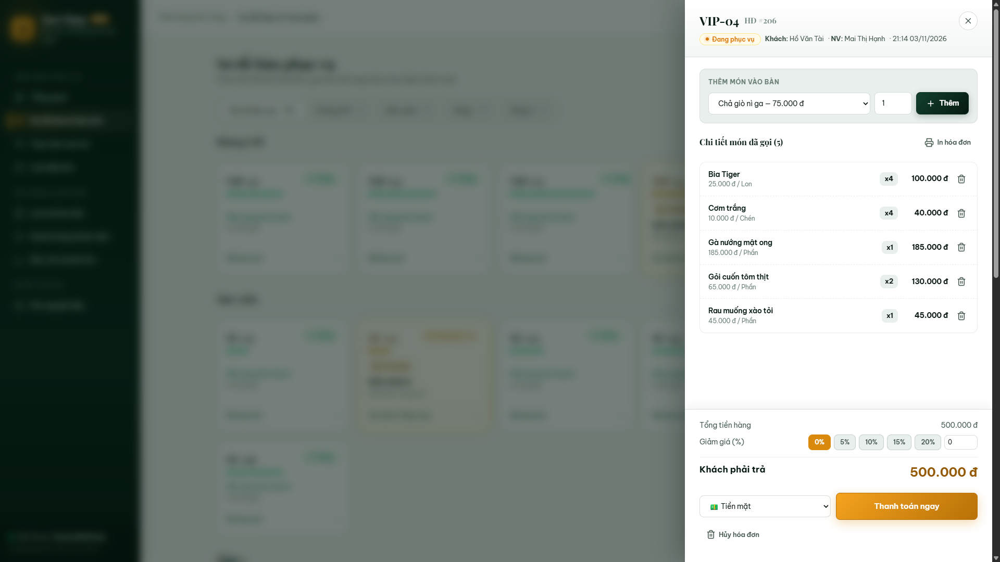
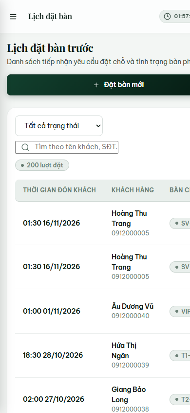

# 🍽️ HỆ THỐNG QUẢN LÝ NHÀ HÀNG "SEN VÀNG" (SEN VÀNG RESTAURANT MANAGEMENT SYSTEM)

[](https://www.microsoft.com/sql-server/)
[](https://nodejs.org/)
[](https://expressjs.com/)
[](https://learn.microsoft.com/)
[](LICENSE)
[-brightgreen)](FINAL_REVIEW_REPORT.md)

> **Đồ án môn học**: Hệ quản trị cơ sở dữ liệu (DBMS - Database Management Systems)  
> **Nền tảng công nghệ**: Microsoft SQL Server (T-SQL, Transactions ACID, Trigger, Stored Procedure) & Web Full-Stack (Node.js, Express, Modern Glassmorphism Responsive UI).

---

## 📌 MỤC LỤC
1. [Cấu trúc thư mục dự án](#1-cấu-trúc-thư-mục-dự-án)
2. [Chi tiết các đối tượng CSDL & Nghiệp vụ](#2-chi-tiết-các-đối-tượng-csdl--nghiệp-vụ)
   - [Hệ thống 10 bảng thực thể + 1 bảng log](#21-hệ-thống-10-bảng-nghiệp-vụ--1-bảng-audit-log)
   - [10 Chỉ mục tối ưu hóa & Toàn vẹn](#22-10-chỉ-mục-tối-ưu-hóa--toàn-vẹn-non-clustered--filtered-unique-indexes)
   - [6 Hàm nghiệp vụ (User-Defined Functions)](#23-6-hàm-nghiệp-vụ-udfs)
   - [8 Khung nhìn (Views)](#24-8-khung-nhìn-views)
   - [7 Thủ tục lưu trữ giao dịch (Stored Procedures)](#25-7-thủ-tục-lưu-trữ-stored-procedures)
   - [3 Trigger kiểm soát toàn vẹn](#26-3-trigger-kiểm-soát-toàn-vẹn--đồng-bộ-trạng-thái)
   - [16 Truy vấn nghiệp vụ nâng cao](#27-16-truy-vấn-nghiệp-vụ-nâng-cao)
3. [Kịch bản kiểm thử & Toàn vẹn dữ liệu](#3-kịch-bản-kiểm-thử--toàn-vẹn-dữ-liệu)
4. [Dữ liệu mẫu & Kiểm toán chất lượng](#4-dữ-liệu-mẫu--kiểm-toán-chất-lượng)
5. [Giao diện Web POS ("Sen Vàng POS")](#5-giao-diện-web-pos-sen-vàng-pos)
6. [Hướng dẫn cài đặt & Triển khai](#6-hướng-dẫn-cài-đặt--triển-khai)
   - [Yêu cầu môi trường](#61-yêu-cầu-môi-trường)
   - [Cài đặt Database (3 cách)](#62-cài-đặt-database)
   - [Nạp dữ liệu lớn 3.006 hóa đơn (2020-2026)](#63-nạp-dữ-liệu-lớn-3006-hóa-đơn-2020-2026)
   - [Khởi chạy ứng dụng Web POS](#64-khởi-chạy-ứng-dụng-web-pos)
7. [Danh sách API Endpoints](#7-danh-sách-api-endpoints)
8. [Khắc phục sự cố thường gặp (FAQ)](#8-khắc-phục-sự-cố-thường-gặp-faq)
9. [Tài liệu & Báo cáo đính kèm](#9-tài-liệu--báo-cáo-đính-kèm)

---

## 1. CẤU TRÚC THƯ MỤC DỰ ÁN

```plaintext
Quan-ly-nha-hang-master/
├── README.md                           # Tài liệu hướng dẫn toàn diện của dự án
├── FINAL_REVIEW_REPORT.md              # Báo cáo kiểm toán độc lập đối chiếu 100% tiêu chí đề bài tập lớn
├── REMEDIATION_REPORT.md               # Báo cáo kỹ thuật chi tiết các bản vá và tối ưu hóa hệ thống
│
├── sql/                                # TẬP LỆNH SQL SERVER (T-SQL) MODULAR
│   ├── 01_CreateDatabase_Tables.sql    # Tạo DB, 10 bảng chính, 1 bảng log, chuẩn hóa ràng buộc DATEADD & SĐT
│   ├── 02_InsertData.sql               # Dữ liệu mẫu nền tảng: danh mục, món, nguyên liệu, bàn, nhân sự, khách hàng
│   ├── 02_InsertData_3000_2020_2025.sql# Dữ liệu lớn (3.006 hóa đơn, 15.775 chi tiết, 450 đặt bàn, 2020–2026)
│   ├── 03_Index_Function_View.sql      # 10 Index (8 Non-Clustered + 2 Filtered Unique), 6 Function, 8 View
│   ├── 04_StoredProcedures_Triggers.sql# 7 Stored Procedure giao dịch chống Race Condition, 3 Trigger
│   ├── 05_Queries.sql                  # 16 câu truy vấn nâng cao tối ưu SARGable (Q5 Tháng 10/2026, Q6 Năm 2025 > 50M)
│   ├── 06_Test_Demo.sql                # Kịch bản kiểm thử: Demo POS, 10 ca vi phạm ràng buộc, Rollback
│   ├── 07_DataIntegrity_Audit.sql      # Kịch bản kiểm toán toàn vẹn dữ liệu 10 nhóm nghiệp vụ (0 lỗi)
│   └── fix some constraint.sql         # Script ALTER TABLE vá nhanh ràng buộc tuổi & SĐT cho DB đang chạy
│
├── báo cáo/                            # BÁO CÁO THUYẾT MINH BÀI TẬP LỚN & HỒ SƠ KIỂM TOÁN
│   ├── Quản lý nhà hàng.docx           # ⭐ Báo cáo đồ án chính thức (Word - đã cập nhật đầy đủ số liệu mới nhất)
│   ├── Quản lý nhà hàng.pdf            # ⭐ Bản in báo cáo chính thức hoàn chỉnh (PDF)
│   ├── BaoCao_QuanLyNhaHang.docx       # Báo cáo đồ án (bản dự phòng chuẩn kỹ thuật)
│   ├── BaoCao_QuanLyNhaHang.pdf        # Bản in PDF (bản dự phòng chuẩn kỹ thuật)
│   ├── BaoCao_KiemToanDocLap_QuanLyNhaHang.docx # Hồ sơ kiểm toán độc lập đối chiếu đề bài (Word)
│   └── BaoCao_KiemToanDocLap_QuanLyNhaHang.pdf  # Bản in hồ sơ kiểm toán độc lập (PDF)
│
├── web/                                # ỨNG DỤNG WEB POS (FULL-STACK NODE.JS + EXPRESS)
│   ├── server.js                       # Backend REST API (Validation, Error Masking, UTC+7, Locking)
│   ├── package.json                    # Cấu hình dependency & script kiểm thử tự động (npm test)
│   ├── .env.example                    # Mẫu cấu hình chuỗi kết nối SQL Server & bảo mật
│   ├── test/                           # Bộ kiểm thử tự động (Unit, API Integration, Transaction, Concurrency)
│   │   └── remediation.test.js         # 13 test suites chạy trực tiếp trên SQL Server thực tế (100% Pass)
│   └── public/                         # Frontend Single Page Application (SPA - ES Modules)
│       ├── index.html                  # Giao diện chính POS (Glassmorphism layout)
│       ├── css/app.css                 # Hệ thống style responsive, anti-jiggle, hiệu ứng
│       ├── js/app.js                   # Entrypoint điều phối SPA & Delegated Event Listeners
│       ├── js/modules/                 # Các module tách theo chức năng nghiệp vụ
│       │   ├── core.js                 # Tiện ích định dạng, múi giờ Asia/Ho_Chi_Minh, XSS Escaping, API
│       │   ├── effects.js              # Hiệu ứng 3D Tilt, Magnetic Button, Animated Counter
│       │   ├── dashboard.js            # Tổng quan điều hành & Báo cáo doanh thu (SVG Charts)
│       │   ├── pos.js                  # Sơ đồ bàn, Mở bàn, Ngăn kéo gọi món, Thanh toán, Hủy đơn
│       │   ├── menu.js                 # Quản lý Thực đơn món ăn & Định lượng nguyên liệu
│       │   └── operations.js           # Quản lý Đặt bàn, Hóa đơn, Khách hàng CRM, Nhập kho, Nhân sự
│       ├── js/anime.min.js             # Thư viện hiệu ứng mượt mà
│       └── screenshots/                # Bộ sưu tập ảnh chụp màn hình các phân hệ giao diện
│
├── slides/                             # TÀI LIỆU BÁO CÁO & THUYẾT TRÌNH BẢO VỆ
│   ├── Slides_QuanLyNhaHang.pptx       # Slide thuyết trình đồ án PowerPoint 30 slides chuyên nghiệp
│   ├── spec_30_slides.json             # Đặc tả chi tiết cấu trúc và nội dung 30 slides
│   └── renders/                        # Thư mục 30 ảnh kết xuất chất lượng cao từng slide (s001 - s030)
│
├── erd/                                # SƠ ĐỒ THỰC THỂ - QUAN HỆ (ERD)
│   ├── erd.png                         # Ảnh sơ đồ vật lý (Crow's Foot)
│   ├── erd_chen.png                    # Ảnh sơ đồ quan niệm (Chen Notation)
│   ├── erd_chen.svg                    # File vector SVG chất lượng cao
│   ├── erd_viewer.html                 # Trình xem tương tác HTML cho lược đồ Crow's Foot
│   ├── erd_chen_viewer.html            # Trình xem tương tác HTML cho mô hình Chen
│   └── *.py                            # Các script Python tự động kết xuất sơ đồ (Graphviz/Matplotlib)
│
└── scripts/                            # Các công cụ script bổ trợ (sinh dữ liệu, đồng bộ tài liệu Word/PDF)
```

---

## 2. CHI TIẾT CÁC ĐỐI TƯỢNG CSDL & NGHIỆP VỤ

### 2.1. Hệ thống 10 Bảng nghiệp vụ + 1 Bảng Audit Log

| STT | Tên bảng | Chức năng nghiệp vụ | Khóa chính (PK) | Ràng buộc toàn vẹn tiêu biểu |
|:---:|---|---|:---:|---|
| 1 | `KhachHang` | Thông tin khách hàng, thẻ hội viên, CRM | `MaKH` | `UQ(SoDienThoai)`, `CK_KhachHang_SDT` (bắt buộc đầu số `0[0-9]%`, 10–11 chữ số, không chứa ký tự lạ), `CK_Email`, `CK(DiemTichLuy >= 0)` |
| 2 | `NhanVien` | Nhân sự, phục vụ, thu ngân, bếp, quản lý | `MaNV` | `UQ(SoDienThoai)`, `UQ_NhanVien_Email (Filtered Index: WHERE Email IS NOT NULL)`, `CK_NhanVien_TuoiLaoDong (NgayVaoLam >= DATEADD(YEAR, 18, NgaySinh))`, `CK_NhanVien_SDT` (đầu số 0, 10–11 số), `CK(Luong >= 4tr)` |
| 3 | `BanAn` | Sơ đồ bàn theo khu vực, sức chứa | `MaBan` | `UQ(TenBan)`, `CK(SoCho BETWEEN 1 AND 20)`, `CK(KhuVuc IN (...))` |
| 4 | `DanhMucMon` | Danh mục phân loại ẩm thực | `MaDM` | `UQ(TenDM)` |
| 5 | `MonAn` | Thực đơn nhà hàng, đơn giá niêm yết | `MaMon` | `FK(MaDM)`, `UQ(TenMon)`, `CK(DonGia > 0)` |
| 6 | `NguyenLieu` | Quản lý kho, tồn kho, định mức an toàn | `MaNL` | `UQ(TenNL)`, `CK(SoLuongTon >= 0)`, `CK(MucToiThieu >= 0)` |
| 7 | `CongThuc` | Định lượng nguyên liệu cho từng món (BOM) | `(MaMon, MaNL)` | `FK(MaMon) ON DELETE CASCADE`, `FK(MaNL)`, `CK(DinhLuong > 0)` |
| 8 | `DatBan` | Lịch hẹn đặt bàn của thực khách | `MaDatBan` | `FK(MaKH)`, `FK(MaBan)`, `CK(SoNguoi BETWEEN 1 AND 20)` |
| 9 | `HoaDon` | Hóa đơn thanh toán, trạng thái, chiết khấu | `MaHD` | `FK(MaBan)`, `FK(MaKH)`, `FK(MaNV)`, `CK(GiamGia 0-100%)`, `CK_ThoiGian` |
| 10 | `ChiTietHoaDon` | Món ăn gọi theo từng hóa đơn, số lượng, đơn giá | `(MaHD, MaMon)` | `FK(MaHD) ON DELETE CASCADE`, `FK(MaMon)`, `ThanhTien AS (SoLuong * DonGia) PERSISTED` |
| 11 | `NhatKyHoaDon` | *Bảng Audit log*: ghi nhận lịch sử mở, thêm món, thanh toán, hủy đơn | `MaNK` | Tự động ghi thời gian `GETDATE()` và `SUSER_SNAME()` |

---

### 2.2. 10 Chỉ mục tối ưu hóa & Toàn vẹn (Non-Clustered & Filtered Unique Indexes)

Được thiết kế dựa trên tần suất xuất hiện trong các mệnh đề `WHERE`, `JOIN` và `ORDER BY`, kết hợp kỹ thuật **Covering Index** (`INCLUDE`) và **Filtered Unique Index**:

1. `IX_HoaDon_ThoiGianLap`: Lọc theo thời gian lập hóa đơn, bao gồm `INCLUDE (TrangThai, ThanhToan)`.
2. `IX_HoaDon_TrangThai`: Lọc theo trạng thái và bàn ăn `(TrangThai, MaBan)`.
3. `IX_HoaDon_MaKH`: Tối ưu hóa truy vấn lịch sử tiêu dùng theo khách hàng.
4. `IX_HoaDon_MaNV`: Tối ưu hóa thống kê hiệu suất doanh số nhân viên.
5. `UQ_HoaDon_BanDangPhucVu`: **Filtered Unique Index** trên `(MaBan) WHERE TrangThai = N'Đang phục vụ'` — chặn tuyệt đối việc mở 2 hóa đơn đồng thời trên cùng một bàn ở cấp độ Storage Engine.
6. `UQ_NhanVien_Email`: **Filtered Unique Index** trên `(Email) WHERE Email IS NOT NULL` — cho phép nhiều nhân viên chưa có email (`NULL`) nhưng đảm bảo không trùng email khi có giá trị.
7. `IX_ChiTietHoaDon_MaMon`: Thống kê món bán chạy, bao gồm `INCLUDE (SoLuong, ThanhTien)`.
8. `IX_MonAn_MaDM`: Tăng tốc lọc thực đơn theo danh mục.
9. `IX_DatBan_ThoiGianDat`: Tối ưu tìm kiếm lịch đặt bàn theo khung giờ (`Index Seek` với truy vấn SARGable), bao gồm `INCLUDE (TrangThai)`.
10. `IX_KhachHang_HoTen`: Tìm kiếm nhanh thông tin khách hàng theo tên.

---

### 2.3. 6 Hàm nghiệp vụ (UDFs)

* `fn_TinhTuoi(@NgaySinh)`: Tính tuổi chính xác theo ngày tháng năm sinh thực tế.
* `fn_TinhTienPhaiTra(@MaHD)`: Tính tổng tiền thực khách phải trả của hóa đơn sau khi trừ tỷ lệ chiết khấu giảm giá.
* `fn_TinhThueVAT(@SoTien, @TyLe)`: Tính tiền thuế VAT (mặc định 8%).
* `fn_XepHangKhachHang(@Diem)`: Phân hạng thành viên: $\ge 1.000$ điểm: *Kim cương*, $\ge 500$: *Vàng*, $\ge 200$: *Bạc*, còn lại: *Đồng*.
* `fn_MonBanChay(@TuNgay, @DenNgay)`: *(Inline Table-Valued)* Thống kê danh sách món bán chạy nhất kèm số lượng và doanh thu trong một khoảng thời gian bất kỳ.
* `fn_BanTrongTrongKhungGio(@MaBan, @ThoiGian)`: Kiểm tra bàn có khả dụng trong khung giờ mong muốn hay không (kiểm tra xung đột lịch đặt trong phạm vi $\pm 2$ giờ).

---

### 2.4. 8 Khung nhìn (Views)

* `vw_ThucDon`: Danh sách thực đơn đầy đủ kèm tên danh mục cho các món đang kinh doanh (`ConKinhDoanh = 1`).
* `vw_MonDangKinhDoanh`: Khung nhìn cập nhật được với ràng buộc `WITH CHECK OPTION` nhằm ngăn chặn chèn hoặc sửa món đã ngừng kinh doanh.
* `vw_TinhTrangBan`: Hiển thị sơ đồ bàn ăn thời gian thực: trạng thái, hóa đơn đang mở, số phút khách đã ngồi, nhân viên phục vụ.
* `vw_ChiTietHoaDonDayDu`: Dữ liệu tổng hợp dùng cho việc in hóa đơn chi tiết gửi khách hàng.
* `vw_DoanhThuTheoNgay`: Thống kê tổng hợp số hóa đơn, doanh thu và giá trị trung bình đơn theo từng ngày.
* `vw_NguyenLieuSapHet`: Cảnh báo nguyên liệu chạm hoặc dưới mức tối thiểu an toàn, kèm dự toán kinh phí cần nhập bù.
* `vw_KhachHangThanThiet`: Thống kê tần suất dùng bữa, tổng chi tiêu và xếp hạng hội viên của từng khách hàng.
* `vw_DatBanSapToi`: Danh sách lịch đặt bàn sắp diễn ra từ hôm nay trở về sau.

---

### 2.5. 7 Thủ tục lưu trữ (Stored Procedures)

Mọi thủ tục đều tích hợp **Transaction ACID**, chỉ thị `SET XACT_ABORT ON`, bao trùm toàn bộ pha đọc-kiểm-tra và cập nhật trong `BEGIN TRANSACTION ... COMMIT` với gợi ý khóa `WITH (UPDLOCK, HOLDLOCK)`, khối bẫy lỗi `BEGIN TRY ... BEGIN CATCH`, thu hồi thao tác `ROLLBACK` và phát thông điệp lỗi chuẩn xác với `THROW`:

1. `sp_MoHoaDon`: Mở hóa đơn mới khi khách nhận bàn, chuyển trạng thái bàn sang *Đang phục vụ*, tự động khớp và chuyển lịch đặt bàn trước sang *Đã đến*, ghi nhật ký. Khóa dòng bàn với `UPDLOCK, HOLDLOCK` và kết hợp Filtered Index `UQ_HoaDon_BanDangPhucVu` triệt tiêu nguy cơ mở trùng 2 hóa đơn cho 1 bàn.
2. `sp_ThemMonVaoHoaDon`: Thêm món vào hóa đơn; **tự động kiểm tra tồn kho theo định mức nguyên liệu (BOM)** trong transaction, báo lỗi nếu thiếu nguyên vật liệu; **tự động trừ số lượng tồn kho nguyên liệu tương ứng**, cộng dồn số lượng nếu món đã tồn tại trong hóa đơn.
3. `sp_ThanhToanHoaDon`: Tính tổng tiền, áp dụng chiết khấu %, cập nhật trạng thái *Đã thanh toán* (kiểm tra `IF @@ROWCOUNT = 0`), **tự động tích điểm CRM cho khách hàng** bằng `CAST(FLOOR(@SoTienPhaiTra / 10000.0) AS INT)` (1 điểm / 10.000 VNĐ), **tự động đồng bộ trạng thái bàn** (chuyển sang *Đã đặt* nếu còn lịch đặt hợp lệ trong ngày hoặc *Trống* nếu không còn), trả về số tiền phải trả qua tham số `OUTPUT`.
4. `sp_HuyHoaDon`: Hủy hóa đơn đang phục vụ; **tự động hoàn trả toàn bộ nguyên liệu** đã xuất kho theo định lượng được gộp nhóm an toàn `GROUP BY c.MaNL` (loại trừ lỗi hoàn trùng nguyên liệu khi nhiều món dùng chung thành phần), giải phóng bàn theo lịch đặt, ghi nhận lý do hủy và log kiểm toán.
5. `sp_DatBan`: Tiếp nhận đặt bàn; tự động kiểm tra số người không vượt quá sức chứa bàn (`SoNguoi <= SoCho`) và kiểm tra tránh xung đột khung giờ hẹn trong cửa sổ SARGable $\pm 120$ phút với khóa Key-Range.
6. `sp_BaoCaoDoanhThuTheoThang`: Tổng hợp kết quả kinh doanh 12 tháng trong năm theo khoảng thời gian SARGable (doanh thu, số hóa đơn, khách thành viên, chiết khấu) và xuất ra tổng doanh thu cả năm qua tham số `OUTPUT`.
7. `sp_NhapKhoNguyenLieu`: Nhập thêm số lượng nguyên liệu vào kho và cập nhật đơn giá nhập kho mới nhất trong transaction an toàn.

---

### 2.6. 3 Trigger kiểm soát toàn vẹn & đồng bộ trạng thái

* `trg_ChiTietHoaDon_CapNhatTongTien`: Tự động tính toán lại `TongTien` và `ThanhToan` trên bảng `HoaDon` bất cứ khi nào bảng `ChiTietHoaDon` phát sinh thao tác `INSERT`, `UPDATE` hoặc `DELETE`.
* `trg_ChiTietHoaDon_KhoaHoaDonDaThanhToan`: Tuyệt đối ngăn chặn thao tác sửa hoặc xóa món ăn trong các hóa đơn đã được thanh toán hoặc đã bị hủy (`ROLLBACK TRANSACTION` và phát thông báo lỗi).
* `trg_DatBan_DongBoTrangThaiBan`: Tự động đồng bộ trạng thái `BanAn.TrangThai` (*Đang phục vụ* / *Đã đặt* / *Trống*) khi phát sinh `INSERT`, `UPDATE`, `DELETE` trên bảng `DatBan`.

---

### 2.7. 16 Truy vấn nghiệp vụ nâng cao

File [sql/05_Queries.sql](sql/05_Queries.sql) bao phủ toàn bộ các kỹ thuật truy vấn dữ liệu từ cơ bản đến phức tạp:
* **Q1**: `WHERE` + `ORDER BY` đa cột (danh sách bàn khu Sân vườn).
* **Q2**: `INNER JOIN` + `BETWEEN` (thực đơn theo tầm giá 50.000đ – 150.000đ).
* **Q3**: `LEFT JOIN` + `IS NULL` (tìm khách hàng chưa từng phát sinh đơn).
* **Q4**: `RIGHT JOIN` (tìm món ăn chưa từng bán được lần nào).
* **Q5**: `FULL OUTER JOIN` (đối chiếu danh sách bàn ăn và lượt đặt bàn trong tháng 10/2026 có dữ liệu thực tế; ưu tiên xếp bàn đã đặt trước lên đầu `ORDER BY CASE WHEN d.MaDatBan IS NOT NULL THEN 0 ELSE 1 END, b.TenBan` giúp nhận diện trực quan bàn có khách đặt vs bàn còn trống).
* **Q6**: `GROUP BY` + `HAVING` (thống kê nhân viên đạt doanh số trên 50 triệu đồng trong năm tài chính 2025 `ThoiGianThanhToan >= '2025-01-01' AND < '2026-01-01'`, `HAVING SUM(h.ThanhToan) > 50000000`, tối ưu hóa index SARGable).
* **Q7**: Subquery vô hướng (món ăn có đơn giá cao hơn mức trung bình của toàn thực đơn).
* **Q8**: Subquery tập hợp với `IN` + `EXISTS` (khách hàng có từ 3 hóa đơn trở lên và có lịch hẹn đặt bàn).
* **Q9**: Toán tử tập hợp `UNION` (tổng hợp danh bạ liên hệ khách hàng và nhân viên).
* **Q10**: Toán tử tập hợp `INTERSECT` (danh sách khách hàng vừa từng đặt bàn vừa từng có hóa đơn đã thanh toán).
* **Q11**: Toán tử tập hợp `EXCEPT` (món đang bán nhưng không phát sinh doanh số trong 30 ngày qua).
* **Q12**: `LIKE` + `UNION ALL` (tìm kiếm linh hoạt theo từ khóa tên món hoặc họ khách).
* **Q13**: `TOP n` kết hợp Table-Valued Function (top 5 món ăn bán chạy nhất trong 90 ngày).
* **Q14**: `TOP PERCENT` kết hợp gọi hàm tính thuế VAT (10% hóa đơn có giá trị lớn nhất).
* **Q15**: Window Function `RANK() OVER (PARTITION BY ...)` (phân tích doanh thu theo khu vực và ca phục vụ, xếp hạng hiệu quả).
* **Q16**: Truy vấn trực tiếp trên View nghiệp vụ (`vw_KhachHangThanThiet` - top 10 khách hàng thân thiết có chi tiêu cao nhất).

---

## 3. KỊCH BẢN KIỂM THỬ & TOÀN VẸN DỮ LIỆU

Hệ thống được kiểm thử tự động trong file [sql/06_Test_Demo.sql](sql/06_Test_Demo.sql) với 10 ca kiểm tra vi phạm ràng buộc có bẫy lỗi `TRY...CATCH`:

```
========================================================================================
MÃ CA    LOẠI RÀNG BUỘC / NGHIỆP VỤ           THAO TÁC THỰC HIỆN              KẾT QUẢ MONG ĐỢI
========================================================================================
[C1]     CHECK Constraint                     Chèn bàn có SoCho = 0           LỖI vi phạm CK_BanAn_SoCho
[C2]     UNIQUE Constraint                    Chèn trùng số điện thoại        LỖI vi phạm UQ_KhachHang_SoDienThoai
[C3]     FOREIGN KEY Constraint               Chèn món với MaDM không có      LỖI vi phạm FK_MonAn_DanhMucMon
[C4]     NOT NULL Constraint                  Chèn khách hàng thiếu họ tên    LỖI không cho phép giá trị NULL
[C5]     CHECK Constraint                     Cập nhật GiamGia = 150%         LỖI vi phạm CK_HoaDon_GiamGia
[C6]     FK ON DELETE RESTRICT                Xóa danh mục đang có món        LỖI vi phạm ràng buộc khóa ngoại
[C7]     WITH CHECK OPTION                    Chèn món ngừng bán qua view     LỖI vi phạm view WITH CHECK OPTION
[C8]     Stored Procedure Logic               Thanh toán lại đơn đã xong      LỖI nghiệp vụ (hóa đơn đã đóng)
[C9]     Quản trị tồn kho (SP)                Gọi 100 cua (kho tồn 15kg Cua thịt) LỖI: "Không đủ nguyên liệu: Cua thịt"
[C10]    Trigger kiểm soát                    Sửa chi tiết đơn đã trả tiền    LỖI Trigger: Hóa đơn đã khóa
========================================================================================
```

### Minh họa chu trình nghiệp vụ bằng SQL thuần:
```sql
USE QuanLyNhaHang;

-- 1. Mở hóa đơn bàn 1, nhân viên 4 phục vụ, khách hàng 2
DECLARE @hd INT, @tien DECIMAL(14,0);
EXEC sp_MoHoaDon @MaBan = 1, @MaNV = 4, @MaKH = 2, @MaHD = @hd OUTPUT;

-- 2. Gọi món (Hệ thống tự kiểm tra tồn kho và trừ nguyên liệu)
EXEC sp_ThemMonVaoHoaDon @hd, 7, 1;   -- 1 Gà nướng mật ong
EXEC sp_ThemMonVaoHoaDon @hd, 35, 2;  -- 2 Bia Tiger

-- 3. Thanh toán bằng Thẻ, áp dụng chiết khấu 10%
EXEC sp_ThanhToanHoaDon @hd, N'Thẻ', 10, @tien OUTPUT;
SELECT @tien AS SoTienKhachPhaiTra;
```

---

## 4. DỮ LIỆU MẪU & KIỂM TOÁN CHẤT LƯỢNG

Dự án cung cấp 2 bộ dữ liệu phục vụ mục đích kiểm thử và đánh giá:
1. **Dữ liệu danh mục & thực thể chuẩn hóa ([sql/02_InsertData.sql](sql/02_InsertData.sql))**:
   - 6 danh mục món, 40 món ăn thuần Việt, 26 nguyên liệu, 68 công thức định lượng, 24 bàn ăn, 15 nhân viên, 100 khách hàng.
2. **Dữ liệu giao dịch thực tế ([sql/02_InsertData_3000_2020_2025.sql](sql/02_InsertData_3000_2020_2025.sql))**:
   - **3.006 hóa đơn** (2.873 Đã thanh toán, 127 Đã hủy, 6 Đang phục vụ) trải dài từ năm 2020 đến 2026.
   - **15.775 dòng chi tiết hóa đơn** (trung bình 3–7 món/hóa đơn), tổng doanh thu thực tế đạt hơn 2,13 tỷ VNĐ.
   - **450 lượt đặt bàn** (394 Đã đến, 56 Đã hủy).
   - **Bảng nhật ký `NhatKyHoaDon`**: Ghi vết thời gian thực mọi biến động hóa đơn, 0 bản ghi mồ côi.
   - Phục vụ kiểm thử hiệu năng, vẽ biểu đồ xu hướng doanh thu nhiều năm và chứng minh hiệu quả chỉ mục Covering Index.

### Kiểm toán toàn vẹn dữ liệu & Bộ kiểm thử tự động:
* **Script kiểm toán SQL ([sql/07_DataIntegrity_Audit.sql](sql/07_DataIntegrity_Audit.sql))**: Kiểm tra tự động 10 nhóm toàn vẹn dữ liệu: (1) hóa đơn trùng bàn & đồng bộ trạng thái bàn, (2) khớp tổng tiền & thành tiền chi tiết, (3) tính toán chiết khấu thanh toán, (4) đặt bàn trùng lịch $\pm 120$ phút & vượt sức chứa bàn, (5) nhất quán tồn kho & định lượng công thức BOM, (6) đối chiếu điểm tích lũy khách hàng `SUM(FLOOR(ThanhToan / 10000.0))`, (7) kiểm tra bản ghi mồ côi, (8) ràng buộc tuổi lao động `NgayVaoLam >= DATEADD(YEAR, 18, NgaySinh)`, (9) định dạng SĐT Việt Nam `0[0-9]%`, (10) lương tối thiểu nhân viên. Khi chạy với bảng mã UTF-8 (`-f 65001`), toàn bộ 10 nhóm kiểm toán đều trả về **0 lỗi**.
* **Bộ kiểm thử tự động ([web/test/remediation.test.js](web/test/remediation.test.js))**: Chạy bằng lệnh `cd web && npm test`, bao gồm 13 test suites (100% PASS) kiểm thử Unit, API Integration, Transaction và Concurrency (10 luồng song song kiểm chứng chống race condition cho `sp_MoHoaDon`, `sp_ThanhToanHoaDon`, `sp_HuyHoaDon`, `sp_DatBan` trên SQL Server thực tế).
* **Bản vá độc lập ([sql/fix some constraint.sql](sql/fix%20some%20constraint.sql))**: Cung cấp sẵn các câu lệnh `ALTER TABLE` cập nhật ngay các ràng buộc tuổi lao động và số điện thoại trên CSDL đang chạy mà không cần xóa database.
* **Hồ sơ kiểm toán độc lập**: Chi tiết kết quả đối chiếu toàn bộ yêu cầu đề bài tập lớn tại [FINAL_REVIEW_REPORT.md](FINAL_REVIEW_REPORT.md) và [BaoCao_KiemToanDocLap_QuanLyNhaHang.pdf](<báo cáo/BaoCao_KiemToanDocLap_QuanLyNhaHang.pdf>).

---

## 5. GIAO DIỆN WEB POS ("SEN VÀNG POS")

Ứng dụng Web POS đi kèm được thiết kế theo phong cách hiện đại (Glassmorphism & Clean Typography), giao diện nhạy bén (Responsive) trên mọi kích thước màn hình từ Desktop đến Tablet và Smartphone.

### 5.1. Bảng điều khiển Tổng quan điều hành (Executive Dashboard)
Theo dõi các chỉ số KPI thời gian thực: doanh thu trong ngày, số bàn đang phục vụ, tỷ lệ lấp đầy, biểu đồ doanh thu 14 ngày, top món bán chạy và cảnh báo kho.



### 5.2. Sơ đồ bàn tương tác & Quản lý đặt bàn
Phân chia sơ đồ theo 4 khu vực trực quan với mã màu trạng thái thời gian thực (*Xanh lá: Bàn trống, Vàng: Đang có khách, Tím: Đã đặt trước*). Hỗ trợ mở bàn và tạo lịch đặt bàn mới.



### 5.3. Ngăn kéo gọi món thông minh & Thanh toán (POS Order Drawer)
Thao tác chọn món trực quan theo danh mục, thêm món kèm trừ kho nguyên liệu tức thời, chọn khách thành viên để hưởng ưu đãi và thanh toán đa phương thức.



### 5.4. Giao diện đáp ứng trên Mobile & Tablet (Responsive)
Hỗ trợ nhân viên phục vụ cầm máy tính bảng hoặc điện thoại thông minh để order trực tiếp tại bàn của thực khách.

<p align="center">
  
</p>

---

## 6. HƯỚNG DẪN CÀI ĐẶT & TRIỂN KHAI

### 6.1. Yêu cầu môi trường

| Thành phần | Phiên bản yêu cầu | Ghi chú |
|---|---|---|
| **Hệ điều hành** | Windows 10/11, Windows Server (hoặc Linux qua Docker) | Hỗ trợ tốt nhất trên Windows |
| **Hệ quản trị CSDL** | Microsoft SQL Server 2019 / 2022 (Express, Developer hoặc Enterprise) | Collation `Vietnamese_CI_AS` |
| **Công cụ quản lý** | SQL Server Management Studio (SSMS) 19+ hoặc Azure Data Studio | Khuyên dùng SSMS |
| **Môi trường chạy Web** | Node.js 18.x LTS trở lên & npm 9+ | Để khởi chạy ứng dụng POS |

---

### 6.2. Cài đặt Database

#### CÁCH 1 — Khuyến nghị: Chạy tuần tự các script T-SQL trong thư mục `sql/`
Khởi động **SQL Server Management Studio (SSMS)** và kết nối tới server (ví dụ: `localhost` hoặc `.\SQLEXPRESS`). Mở và thực thi lần lượt các file theo đúng thứ tự phụ thuộc:
1. `sql/01_CreateDatabase_Tables.sql`: Khởi tạo CSDL `QuanLyNhaHang`, tạo 10 bảng thực thể + 1 bảng Audit log, thiết lập khóa chính, khóa ngoại, Filtered Indexes và các ràng buộc chuẩn hóa (`DATEADD` tuổi lao động, định dạng SĐT `0[0-9]%`).
2. `sql/02_InsertData.sql`: Nạp bộ dữ liệu nền tảng (6 danh mục, 40 món ăn, 26 nguyên liệu, 68 công thức, 24 bàn, 15 nhân viên, 100 khách hàng).
3. `sql/03_Index_Function_View.sql`: Tạo 10 chỉ mục tối ưu hóa, 6 hàm nghiệp vụ (UDFs) và 8 khung nhìn (Views).
4. `sql/04_StoredProcedures_Triggers.sql`: Tạo 7 Stored Procedure giao dịch ACID (chống Race Condition) và 3 Trigger kiểm soát toàn vẹn.
5. `sql/05_Queries.sql`: Thực thi 16 câu truy vấn nghiệp vụ nâng cao (đối chiếu bàn Q5, doanh số năm Q6, INTERSECT Q10,...).
6. `sql/06_Test_Demo.sql`: Chạy kịch bản demo chu trình phục vụ POS và kiểm chứng 10 ca vi phạm ràng buộc có bẫy lỗi `TRY...CATCH`.

#### CÁCH 2 — Nâng cấp nhanh ràng buộc cho database hiện hữu (`fix some constraint.sql`)
Nếu CSDL `QuanLyNhaHang` đã tồn tại và đang chứa dữ liệu, bạn có thể áp dụng ngay các bản vá ràng buộc tuổi lao động và số điện thoại mà **không cần xóa hay tạo lại CSDL**:
Mở file `sql/fix some constraint.sql` trong SSMS và nhấn **Execute (F5)** (thực thi các lệnh `ALTER TABLE` an toàn tuyệt đối).

#### CÁCH 3 — Cài đặt tự động bằng dòng lệnh qua `sqlcmd`
Mở Command Prompt hoặc PowerShell tại thư mục gốc dự án và chạy lần lượt:
```bat
sqlcmd -S localhost -E -C -i sql\01_CreateDatabase_Tables.sql -f 65001
sqlcmd -S localhost -E -C -i sql\02_InsertData.sql -f 65001
sqlcmd -S localhost -E -C -i sql\03_Index_Function_View.sql -f 65001
sqlcmd -S localhost -E -C -i sql\04_StoredProcedures_Triggers.sql -f 65001
sqlcmd -S localhost -E -C -i sql\05_Queries.sql -f 65001
sqlcmd -S localhost -E -C -i sql\06_Test_Demo.sql -f 65001
```
> 💡 **Ghi chú về tham số dòng lệnh**:
> - `-C` (*Trust Server Certificate*): Bắt buộc đối với ODBC Driver 18 và SQL Server 2022/2025 để tránh lỗi từ chối chứng chỉ tự ký (`The certificate chain was issued by an authority that is not trusted`).
> - `-f 65001`: Thiết lập mã hóa UTF-8 để đảm bảo nạp chính xác tiếng Việt có dấu.

---

### 6.3. Nạp dữ liệu lớn 3.006 hóa đơn (2020 – 2026)
Để phục vụ việc báo cáo doanh thu nhiều năm, đánh giá tải hoặc demo đồ án ấn tượng:
```bat
sqlcmd -S localhost -E -C -d QuanLyNhaHang -i sql\02_InsertData_3000_2020_2025.sql -f 65001
```
*(Hoặc mở file `sql\02_InsertData_3000_2020_2025.sql` trong SSMS và nhấn **F5**).*

---

### 6.4. Khởi chạy ứng dụng Web POS

#### Bước 1: Kích hoạt giao thức TCP/IP trên SQL Server
1. Mở **SQL Server Configuration Manager**.
2. Chọn **SQL Server Network Configuration** → **Protocols for SQLEXPRESS** (hoặc MSSQLSERVER).
3. Chuột phải vào **TCP/IP** → chọn **Enabled**.
4. Chuột phải vào **TCP/IP** → **Properties** → tab **IP Addresses** → kéo xuống mục **IPAll** → đặt **TCP Port** là `1433`.
5. Khởi động lại dịch vụ SQL Server (**SQL Server Services → SQL Server → Restart**).

#### Bước 2: Bật chế độ xác thực kết hợp (SQL Server & Windows Authentication)
Mở SSMS, mở cửa sổ New Query và chạy:
```sql
-- Tạo tài khoản kết nối riêng cho ứng dụng
CREATE LOGIN nhahang_app WITH PASSWORD = 'your password';
USE QuanLyNhaHang;
CREATE USER nhahang_app FOR LOGIN nhahang_app;
ALTER ROLE db_owner ADD MEMBER nhahang_app;
GO
```

#### Bước 3: Cài đặt và chạy ứng dụng
Di chuyển vào thư mục `web/`:
```bash
cd web

# Tạo file cấu hình môi trường từ file mẫu
copy .env.example .env

# Cài đặt các gói thư viện
npm install

# Khởi chạy server
npm start
```

Mở trình duyệt web và truy cập:
👉 **`http://localhost:3000`**

---

## 7. DANH SÁCH API ENDPOINTS

Ứng dụng web giao tiếp với SQL Server thông qua các RESTful API chuẩn mực:

| Phương thức | Endpoint | Chức năng nghiệp vụ | Đối tượng SQL liên kết |
|:---:|---|---|---|
| `GET` | `/api/dashboard` | Thống kê KPI, doanh thu 14 ngày, cảnh báo kho | `vw_DoanhThuTheoNgay`, `fn_MonBanChay`, `vw_NguyenLieuSapHet` |
| `GET` | `/api/baocao/thang?nam=2026` | Báo cáo doanh thu chi tiết 12 tháng theo năm | Stored Procedure `sp_BaoCaoDoanhThuTheoThang` |
| `GET` | `/api/ban` | Lấy danh sách trạng thái bàn ăn và hóa đơn mở | Khung nhìn `vw_TinhTrangBan` |
| `POST` | `/api/hoadon` | Mở hóa đơn mới cho bàn ăn | Stored Procedure `sp_MoHoaDon` |
| `GET` | `/api/hoadon/:id` | Xem chi tiết món, tổng tiền và thuế VAT của hóa đơn | `HoaDon`, `ChiTietHoaDon`, `fn_TinhThueVAT` |
| `POST` | `/api/hoadon/:id/mon` | Gọi thêm món ăn vào hóa đơn (kèm trừ kho) | Stored Procedure `sp_ThemMonVaoHoaDon` |
| `DELETE` | `/api/hoadon/:id/mon/:maMon` | Xóa món khỏi hóa đơn đang phục vụ (hoàn kho) | Transaction ACID + `UPDLOCK, HOLDLOCK` |
| `POST` | `/api/hoadon/:id/thanhtoan`| Tất toán hóa đơn, tích điểm CRM, giải phóng bàn | Stored Procedure `sp_ThanhToanHoaDon` |
| `POST` | `/api/hoadon/:id/huy` | Hủy hóa đơn đang phục vụ, hoàn trả kho 1 lần | Stored Procedure `sp_HuyHoaDon` |
| `GET` | `/api/monan` | Danh sách thực đơn kèm công thức định lượng | `MonAn`, `DanhMucMon`, `CongThuc` |
| `POST` / `PUT` | `/api/monan` / `/api/monan/:id` | Thêm mới / cập nhật món ăn thực đơn | `MonAn` (kiểm tra validation chặt chẽ) |
| `GET` | `/api/datban` | Lấy danh sách lịch hẹn đặt bàn | `DatBan`, `KhachHang`, `BanAn` |
| `POST` | `/api/datban` | Tiếp nhận đặt bàn mới (chống trùng lịch $\pm 2\text{h}$) | Stored Procedure `sp_DatBan` |
| `PUT` | `/api/datban/:id/trangthai` | Cập nhật trạng thái đặt bàn & đồng bộ bàn | Transaction + `trg_DatBan_DongBoTrangThaiBan` |
| `GET` | `/api/nguyenlieu` | Kiểm tra tồn kho và danh sách nguyên liệu sắp hết | `NguyenLieu` |
| `POST` | `/api/nguyenlieu/:id/nhap` | Nhập thêm nguyên liệu vào kho | Stored Procedure `sp_NhapKhoNguyenLieu` |
| `GET` / `POST` | `/api/khachhang` | Danh sách hội viên CRM & đăng ký khách hàng mới | `vw_KhachHangThanThiet`, `KhachHang` |
| `GET` | `/api/nhanvien` | Danh sách nhân sự kèm tính tuổi lao động | `NhanVien`, `fn_TinhTuoi` |

---

## 8. KHẮC PHỤC SỰ CỐ THƯỜNG GẶP (FAQ)

### ❓ 1. Lỗi `Cannot drop database "QuanLyNhaHang" because it is currently in use`
* **Nguyên nhân**: Đang có một kết nối khác (tab query khác trong SSMS hoặc server Node.js đang chạy) chiếm dụng database.
* **Cách xử lý**: Đóng server Node.js và các tab query đang mở, hoặc chạy lệnh sau trong SSMS:
  ```sql
  USE master;
  ALTER DATABASE QuanLyNhaHang SET SINGLE_USER WITH ROLLBACK IMMEDIATE;
  DROP DATABASE QuanLyNhaHang;
  ```

### ❓ 2. Chữ tiếng Việt bị hiển thị thành dấu hỏi `???`
* **Nguyên nhân**: File SQL được mở hoặc thực thi dưới bảng mã ANSI thay vì UTF-8.
* **Cách xử lý**: Toàn bộ script đã được lưu dưới định dạng **UTF-8 with BOM**. Trong SSMS, chọn *File → Save As → Save with Encoding → UTF-8 with Signature*. Nếu dùng `sqlcmd`, luôn thêm cờ `-C -f 65001` để vừa tin cậy chứng chỉ vừa hiển thị đúng font tiếng Việt.

### ❓ 3. Ứng dụng Web báo lỗi `ECONNREFUSED` hoặc `ELOGIN`
* **Nguyên nhân**: Chưa bật TCP/IP cho instance SQL Server hoặc sai tài khoản/mật khẩu trong file `.env`.
* **Cách xử lý**:
  1. Kiểm tra lại cổng TCP/IP = 1433 trong *SQL Server Configuration Manager*.
  2. Kiểm tra thông tin trong file `web/.env`:
     ```ini
     DB_SERVER=localhost
     DB_PORT=1433
     DB_NAME=QuanLyNhaHang
     DB_USER=your_database_user
     DB_PASSWORD=<mat_khau_sql_server>
     DB_TRUST_CERT=true
     ```

### ❓ 4. Lỗi `Failed to connect ... self signed certificate`
* **Cách xử lý**: Đảm bảo trong file `web/.env` đã cấu hình `DB_TRUST_CERT=true`.

---

## 9. TÀI LIỆU & BÁO CÁO ĐÍNH KÈM

Bộ sản phẩm bàn giao đầy đủ của đồ án bao gồm:
* 📄 **Báo cáo đồ án chính thức (Word - đã cập nhật đầy đủ)**: [`báo cáo/Quản lý nhà hàng.docx`](<báo cáo/Quản lý nhà hàng.docx>)
* 📑 **Bản in báo cáo chính thức hoàn chỉnh (PDF)**: [`báo cáo/Quản lý nhà hàng.pdf`](<báo cáo/Quản lý nhà hàng.pdf>)
* 📋 **Hồ sơ kiểm toán độc lập đối chiếu đề bài (Word)**: [`báo cáo/BaoCao_KiemToanDocLap_QuanLyNhaHang.docx`](<báo cáo/BaoCao_KiemToanDocLap_QuanLyNhaHang.docx>)
* 📑 **Bản in hồ sơ kiểm toán độc lập (PDF)**: [`báo cáo/BaoCao_KiemToanDocLap_QuanLyNhaHang.pdf`](<báo cáo/BaoCao_KiemToanDocLap_QuanLyNhaHang.pdf>)
* 🔍 **Báo cáo kiểm toán độc lập chi tiết (Markdown)**: [`FINAL_REVIEW_REPORT.md`](FINAL_REVIEW_REPORT.md)
* 🛠️ **Báo cáo kỹ thuật khắc phục lỗi & tối ưu hóa (Markdown)**: [`REMEDIATION_REPORT.md`](REMEDIATION_REPORT.md)
* 📊 **Slide thuyết trình bảo vệ đồ án (PowerPoint 30 slides)**: [`slides/Slides_QuanLyNhaHang.pptx`](slides/Slides_QuanLyNhaHang.pptx)
* 🖼️ **Ảnh kết xuất từng slide trình chiếu**: [`slides/renders/`](slides/renders/)
* 🗺️ **Sơ đồ thực thể ERD tương tác**: [`erd/erd_viewer.html`](erd/erd_viewer.html) & [`erd/erd_chen_viewer.html`](erd/erd_chen_viewer.html)

---

## 📜 GIẤY PHÉP (LICENSE)
Dự án được phát hành dưới giấy phép mã nguồn mở [MIT License](LICENSE). Mọi cá nhân đều có thể tự do tham khảo, sử dụng và phát triển phục vụ mục đích học tập và nghiên cứu.

---

<p align="center">
  <b>HỆ THỐNG QUẢN LÝ NHÀ HÀNG "SEN VÀNG" — ĐỒ ÁN HỆ QUẢN TRỊ CƠ SỞ DỮ LIỆU</b><br>
  <i>Xây dựng với sự tận tâm và cam kết chất lượng kỹ thuật cao nhất.</i>
</p>
