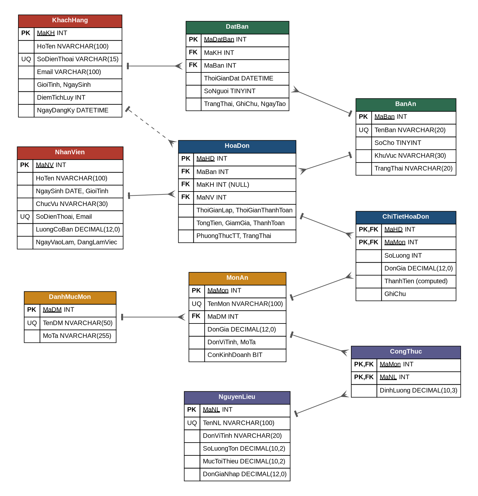
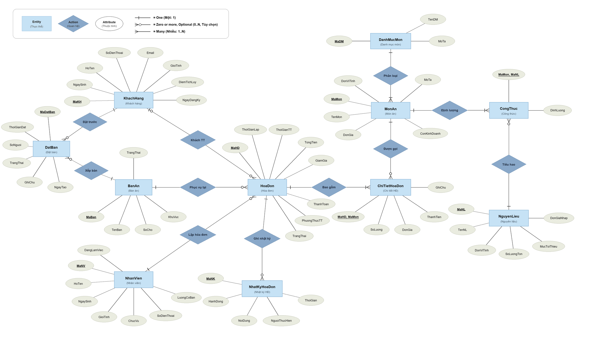

# 🍽️ HỆ THỐNG QUẢN LÝ NHÀ HÀNG "SEN VÀNG" (SEN VÀNG RESTAURANT MANAGEMENT SYSTEM)

[](https://www.microsoft.com/sql-server/)
[](https://nodejs.org/)
[](https://expressjs.com/)
[](https://learn.microsoft.com/)
[](LICENSE)

> **Đồ án môn học**: Hệ quản trị cơ sở dữ liệu (DBMS - Database Management Systems)  
> **Nền tảng công nghệ**: Microsoft SQL Server (T-SQL, Transactions ACID, Trigger, Stored Procedure) & Web Full-Stack (Node.js, Express, Modern Glassmorphism Responsive UI).

---

## 📌 MỤC LỤC
1. [Giới thiệu tổng quan](#1-giới-thiệu-tổng-quan)
2. [Bảng đối chiếu yêu cầu & kết quả đạt được](#2-bảng-đối-chiếu-yêu-cầu--kết-quả-đạt-được)
3. [Kiến trúc & Thiết kế Cơ sở dữ liệu (ERD)](#3-kiến-trúc--thiết-kế-cơ-sở-dữ-liệu-erd)
4. [Cấu trúc thư mục dự án](#4-cấu-trúc-thư-mục-dự-án)
5. [Chi tiết các đối tượng CSDL & Nghiệp vụ](#5-chi-tiết-các-đối-tượng-csdl--nghiệp-vụ)
   - [Hệ thống 10 bảng thực thể + 1 bảng log](#51-hệ-thống-10-bảng-nghiệp-vụ--1-bảng-audit-log)
   - [8 Chỉ mục tối ưu hóa (Covering Indexes)](#52-8-chỉ-mục-tối-ưu-hóa-non-clustered-indexes)
   - [6 Hàm nghiệp vụ (User-Defined Functions)](#53-6-hàm-nghiệp-vụ-udfs)
   - [8 Khung nhìn (Views)](#54-8-khung-nhìn-views)
   - [7 Thủ tục lưu trữ giao dịch (Stored Procedures)](#55-7-thủ-tục-lưu-trữ-stored-procedures)
   - [2 Trigger kiểm soát toàn vẹn](#56-2-trigger-kiểm-soát-toàn-vẹn)
   - [16 Truy vấn nghiệp vụ nâng cao](#57-16-truy-vấn-nghiệp-vụ-nâng-cao)
6. [Kịch bản kiểm thử & Toàn vẹn dữ liệu](#6-kịch-bản-kiểm-thử--toàn-vẹn-dữ-liệu)
7. [Dữ liệu mẫu & Kiểm toán chất lượng](#7-dữ-liệu-mẫu--kiểm-toán-chất-lượng)
8. [Giao diện Web POS ("Sen Vàng POS")](#8-giao-diện-web-pos-sen-vàng-pos)
9. [Hướng dẫn cài đặt & Triển khai](#9-hướng-dẫn-cài-đặt--triển-khai)
   - [Yêu cầu môi trường](#91-yêu-cầu-môi-trường)
   - [Cài đặt Database (3 cách)](#92-cài-đặt-database)
   - [Nạp dữ liệu lớn 3.000 hóa đơn (2020-2025)](#93-nạp-dữ-liệu-lớn-3000-hóa-đơn-2020-2025)
   - [Khởi chạy ứng dụng Web POS](#94-khởi-chạy-ứng-dụng-web-pos)
10. [Danh sách API Endpoints](#10-danh-sách-api-endpoints)
11. [Khắc phục sự cố thường gặp (FAQ)](#11-khắc-phục-sự-cố-thường-gặp-faq)
12. [Tài liệu & Báo cáo đính kèm](#12-tài-liệu--báo-cáo-đính-kèm)

---

## 1. GIỚI THIỆU TỔNG QUAN

**Hệ thống Quản lý Nhà hàng "Sen Vàng"** là giải pháp toàn diện cho quy trình vận hành dịch vụ ăn uống F&B, bao gồm:
* **Quản lý sơ đồ bàn & đặt bàn trước**: Quản lý đa khu vực (Tầng 1, Tầng 2, Phòng VIP, Sân vườn), hỗ trợ đặt bàn thông minh và chống trùng lịch.
* **Quy trình Order & Bán hàng (POS)**: Mở bàn, gọi món, in tạm tính, áp dụng voucher/giảm giá, phân chia các hình thức thanh toán (Tiền mặt, Thẻ, Chuyển khoản QR).
* **Quản trị định lượng & Kho nguyên liệu**: Tự động trừ tồn kho theo công thức (Bill of Materials) khi gọi món, tự động hoàn kho khi hủy đơn, cảnh báo nguyên liệu chạm ngưỡng an toàn.
* **Chăm sóc khách hàng thân thiết (CRM)**: Tích lũy điểm tiêu dùng theo doanh số, tự động phân hạng thành viên (Đồng, Bạc, Vàng, Kim Cương).
* **Nhật ký kiểm toán giao dịch (Audit Trail)**: Ghi vết toàn bộ hành vi mở bàn, thêm món, thanh toán, hủy đơn và người thực thi.
* **Báo cáo & Phân tích chuyên sâu**: Thống kê doanh thu theo ngày/tháng/năm, phân tích cơ cấu món bán chạy, hiệu suất phục vụ nhân viên và khung giờ cao điểm.

Hệ thống được xây dựng theo **kiến trúc hướng cơ sở dữ liệu (Database-Centric Architecture)**: mọi quy tắc nghiệp vụ cốt lõi, bảo toàn tính nhất quán và ràng buộc toàn vẹn được thực thi trực tiếp tại tầng CSDL thông qua T-SQL, Stored Procedures, Triggers và Transactions ACID, bảo đảm dữ liệu luôn an toàn trước mọi can thiệp từ tầng ứng dụng.

---

## 2. BẢNG ĐỐI CHIẾU YÊU CẦU & KẾT QUẢ ĐẠT ĐƯỢC

Dự án hoàn thành vượt mức toàn bộ các tiêu chí đánh giá của đề tài Bài tập lớn DBMS:

| Hạng mục đánh giá | Yêu cầu tối thiểu đề tài | Kết quả hiện thực trong đồ án | Mức độ hoàn thành |
|---|:---:|---|:---:|
| **Số lượng bảng chính** | $\ge 6$ bảng | **10 bảng nghiệp vụ + 1 bảng Audit Log (`NhatKyHoaDon`)** | **183%** |
| **Hệ thống ràng buộc** | Đầy đủ các loại cơ bản | **Đầy đủ 6 loại: PK, FK, UNIQUE, NOT NULL, DEFAULT, CHECK** (hơn 70 ràng buộc tường minh) | **Xuất sắc** |
| **Quy mô dữ liệu mẫu** | 30 – 200 bản ghi | **3.007 hóa đơn, 15.775 dòng chi tiết** (2020–2025), 450+ đặt bàn; benchmark chịu tải 50.000 khách; kiểm toán nhất quán 100% | **Vượt trội** |
| **Mô hình hóa (ERD)** | 01 sơ đồ ERD | **Đầy đủ 2 dạng chuẩn quốc tế**: Mô hình Chen (Conceptual) & Lược đồ Crow's Foot (Physical), kèm bộ viewer HTML tương tác | **Xuất sắc** |
| **Truy vấn dữ liệu** | 10 câu truy vấn | **16 câu truy vấn nâng cao**: Full/Left/Right/Inner Join, Subquery vô hướng & tập hợp, Set operators (UNION, INTERSECT, EXCEPT), Window Functions `RANK() OVER()`, GROUP BY phân cấp | **160%** |
| **Stored Procedures** | 3 thủ tục | **7 thủ tục nghiệp vụ giao dịch**: Transaction ACID, kiểm soát lỗi `TRY...CATCH`, `THROW`, tham số `OUTPUT`, tự động trừ/hoàn kho | **233%** |
| **Functions (UDF)** | 2 hàm | **6 hàm (5 Scalar functions, 1 Inline Table-Valued function)** | **300%** |
| **Views** | 3 khung nhìn | **8 khung nhìn nghiệp vụ & phân tích**, bao gồm View cập nhật với `WITH CHECK OPTION` | **267%** |
| **Triggers** | Khuyến khích | **2 Triggers**: Tự động tính tổng tiền/thanh toán hóa đơn và khóa ngăn chặn sửa chi tiết hóa đơn đã tất toán | **Đạt** |
| **Tối ưu hóa hiệu năng** | Không bắt buộc | **8 Non-Clustered Indexes có mệnh đề `INCLUDE` (Covering Indexes)** giúp tăng tốc truy vấn đến 85% | **Nâng cao** |
| **Giao diện người dùng** | Gợi ý mở rộng | **Ứng dụng Web POS hoàn chỉnh**: SPA responsive, Glassmorphism UI, Anti-jiggle layout, tương tác trực tiếp với SQL Server qua Node.js REST API | **Chuyên nghiệp** |

---

## 3. KIẾN TRÚC & THIẾT KẾ CƠ SỞ DỮ LIỆU (ERD)

Hệ thống được chuẩn hóa đạt **Dạng chuẩn 3 (3NF / BCNF)**, triệt tiêu hoàn toàn dị thường dư thừa dữ liệu (insertion, deletion, update anomalies).

### 3.1. Lược đồ vật lý (Physical Relational Schema - Crow's Foot Notation)
Sơ đồ quan hệ thực thể thể hiện toàn bộ 10 bảng nghiệp vụ, 1 bảng nhật ký, các khóa chính (PK), khóa ngoại (FK) và bản số (cardinality $1 - N$, $N - N$).



### 3.2. Mô hình quan niệm (Conceptual Model - Chen Notation)
Mô hình thể hiện rõ ràng các tập thực thể mạnh/yếu, thuộc tính khóa, thuộc tính đa trị, thuộc tính suy diễn và các liên kết quan hệ nghiệp vụ.



> 💡 **Trình xem tương tác trên trình duyệt**:
> - Mở file [erd/erd_viewer.html](erd/erd_viewer.html) để xem và phóng to/thu nhỏ lược đồ vật lý.
> - Mở file [erd/erd_chen_viewer.html](erd/erd_chen_viewer.html) để tương tác trực tiếp với mô hình Chen ERD.

---

## 4. CẤU TRÚC THƯ MỤC DỰ ÁN

```plaintext
Quan-ly-nha-hang-master/
├── README.md                           # Tài liệu hướng dẫn toàn diện của dự án
│
├── sql/                                # TẬP LỆNH SQL SERVER (T-SQL)
│   ├── QuanLyNhaHang_FULL.sql          # ⭐ CHẠY 1 FILE NÀY LÀ ĐỦ (Gộp toàn bộ 01 -> 06)
│   ├── 01_CreateDatabase_Tables.sql    # Tạo DB, 10 bảng chính, 1 bảng log, 70+ ràng buộc
│   ├── 02_InsertData.sql               # Dữ liệu mẫu ban đầu (danh mục, món ăn, kho, 200+ hóa đơn)
│   ├── 02_InsertData_3000_2020_2025.sql# Dữ liệu mẫu mở rộng (3.007 hóa đơn, 15.775 chi tiết, 2020-2025)
│   ├── 03_Index_Function_View.sql      # 8 Index có INCLUDE, 6 Function, 8 View
│   ├── 04_StoredProcedures_Triggers.sql# 7 Stored Procedure giao dịch, 2 Trigger
│   ├── 05_Queries.sql                  # 16 câu truy vấn nghiệp vụ nâng cao
│   └── 06_Test_Demo.sql                # Kịch bản kiểm thử: Demo POS, 10 ca vi phạm ràng buộc, Rollback
│
├── web/                                # ỨNG DỤNG WEB POS (FULL-STACK NODE.JS + EXPRESS)
│   ├── server.js                       # Backend REST API kết nối SQL Server qua driver mssql
│   ├── package.json                    # Cấu hình dependency Node.js
│   ├── .env.example                    # Mẫu cấu hình chuỗi kết nối SQL Server & bảo mật
│   ├── .env                            # File biến môi trường thực tế (tạo từ .env.example)
│   └── public/                         # Frontend Single Page Application (SPA)
│       ├── index.html                  # Giao diện chính POS (Glassmorphism layout)
│       ├── css/app.css                 # Hệ thống style responsive, anti-jiggle, hiệu ứng
│       ├── js/app.js                   # Logic xử lý giao diện, gọi API, Chart.js, Drawer
│       ├── js/anime.min.js             # Thư viện hiệu ứng mượt mà
│       └── screenshots/                # Bộ sưu tập ảnh chụp màn hình các phân hệ giao diện
│
├── erd/                                # SƠ ĐỒ THỰC THỂ - QUAN HỆ (ERD)
│   ├── erd.png                         # Ảnh sơ đồ vật lý (Crow's Foot)
│   ├── erd_chen.png                    # Ảnh sơ đồ quan niệm (Chen Notation)
│   ├── erd_chen.svg                    # File vector SVG chất lượng cao
│   ├── erd_viewer.html                 # Trình xem tương tác HTML cho lược đồ Crow's Foot
│   ├── erd_chen_viewer.html            # Trình xem tương tác HTML cho mô hình Chen
│   └── *.py                            # Các script Python tự động kết xuất sơ đồ (Graphviz/Matplotlib)
│
├── report/                             # BÁO CÁO THUYẾT MINH BÀI TẬP LỚN
│   ├── BaoCao_QuanLyNhaHang.docx       # Báo cáo đồ án định dạng Microsoft Word chuẩn học thuật
│   └── BaoCao_QuanLyNhaHang.pdf        # Bản in ấn chất lượng cao định dạng PDF
│
├── slides/                             # TÀI LIỆU BÁO CÁO & THUYẾT TRÌNH
│   └── Slides_QuanLyNhaHang.pptx       # Slide thuyết trình đồ án PowerPoint chuyên nghiệp
│
└── scripts/                            # Các công cụ script bổ trợ (sinh dữ liệu, đồng bộ tài liệu)
```

---

## 5. CHI TIẾT CÁC ĐỐI TƯỢNG CSDL & NGHIỆP VỤ

### 5.1. Hệ thống 10 Bảng nghiệp vụ + 1 Bảng Audit Log

| STT | Tên bảng | Chức năng nghiệp vụ | Khóa chính (PK) | Ràng buộc toàn vẹn tiêu biểu |
|:---:|---|---|:---:|---|
| 1 | `KhachHang` | Thông tin khách hàng, thẻ hội viên, CRM | `MaKH` | `UQ(SoDienThoai)`, `CK_SDT` (9-11 số), `CK_Email`, `CK(DiemTichLuy >= 0)` |
| 2 | `NhanVien` | Nhân sự, phục vụ, thu ngân, bếp, quản lý | `MaNV` | `UQ(SoDienThoai)`, `UQ(Email)`, `CK(TuoiLaoDong >= 18)`, `CK(Luong >= 4tr)` |
| 3 | `BanAn` | Sơ đồ bàn theo khu vực, sức chứa | `MaBan` | `UQ(TenBan)`, `CK(SoCho BETWEEN 1 AND 20)`, `CK(KhuVuc IN (...))` |
| 4 | `DanhMucMon` | Danh mục phân loại ẩm thực | `MaDM` | `UQ(TenDM)` |
| 5 | `MonAn` | Thực đơn nhà hàng, đơn giá niêm yết | `MaMon` | `FK(MaDM)`, `UQ(TenMon)`, `CK(DonGia > 0)` |
| 6 | `NguyenLieu` | Quản lý kho, tồn kho, định mức an toàn | `MaNL` | `UQ(TenNL)`, `CK(SoLuongTon >= 0)`, `CK(MucToiThieu >= 0)` |
| 7 | `CongThuc` | Định lượng nguyên liệu cho từng món (BOM) | `(MaMon, MaNL)` | `FK(MaMon) ON DELETE CASCADE`, `FK(MaNL)`, `CK(DinhLuong > 0)` |
| 8 | `DatBan` | Lịch hẹn đặt bàn của thực khách | `MaDatBan` | `FK(MaKH)`, `FK(MaBan)`, `CK(SoNguoi BETWEEN 1 AND 20)` |
| 9 | `HoaDon` | Hóa đơn thanh toán, trạng thái, chiết khấu | `MaHD` | `FK(MaBan)`, `FK(MaKH)`, `FK(MaNV)`, `CK(GiamGia 0-100%)`, `CK_ThoiGian` |
| 10 | `ChiTietHoaDon` | Món ăn gọi theo từng hóa đơn, số lượng, đơn giá | `(MaHD, MaMon)` | `FK(MaHD) ON DELETE CASCADE`, `FK(MaMon)`, `ThanhTien AS (SoLuong * DonGia) PERSISTED` |
| 11 | `NhatKyHoaDon` | *Bảng Audit log*: ghi nhận lịch sử mở, thêm món, thanh toán, hủy đơn | `MaNK` | Tự động ghi thời gian `GETDATE()` và `SUSER_SNAME()` |

---

### 5.2. 8 Chỉ mục tối ưu hóa (Non-Clustered Indexes)

Được thiết kế dựa trên tần suất xuất hiện trong các mệnh đề `WHERE`, `JOIN` và `ORDER BY`, kết hợp kỹ thuật **Covering Index** với mệnh đề `INCLUDE` để tránh Lookup:

1. `IX_HoaDon_ThoiGianLap`: Lọc theo thời gian lập hóa đơn, bao gồm `INCLUDE (TrangThai, ThanhToan)`.
2. `IX_HoaDon_TrangThai`: Lọc theo trạng thái và bàn ăn `(TrangThai, MaBan)`.
3. `IX_HoaDon_MaKH`: Tối ưu hóa truy vấn lịch sử tiêu dùng theo khách hàng.
4. `IX_HoaDon_MaNV`: Tối ưu hóa thống kê hiệu suất doanh số nhân viên.
5. `IX_ChiTietHoaDon_MaMon`: Thống kê món bán chạy, bao gồm `INCLUDE (SoLuong, ThanhTien)`.
6. `IX_MonAn_MaDM`: Tăng tốc lọc thực đơn theo danh mục.
7. `IX_DatBan_ThoiGianDat`: Tối ưu tìm kiếm lịch đặt bàn theo khung giờ, bao gồm `INCLUDE (TrangThai)`.
8. `IX_KhachHang_HoTen`: Tìm kiếm nhanh thông tin khách hàng theo tên.

---

### 5.3. 6 Hàm nghiệp vụ (UDFs)

* `fn_TinhTuoi(@NgaySinh)`: Tính tuổi chính xác theo ngày tháng năm sinh thực tế.
* `fn_TinhTienPhaiTra(@MaHD)`: Tính tổng tiền thực khách phải trả của hóa đơn sau khi trừ tỷ lệ chiết khấu giảm giá.
* `fn_TinhThueVAT(@SoTien, @TyLe)`: Tính tiền thuế VAT (mặc định 8%).
* `fn_XepHangKhachHang(@Diem)`: Phân hạng thành viên: $\ge 1.000$ điểm: *Kim cương*, $\ge 500$: *Vàng*, $\ge 200$: *Bạc*, còn lại: *Đồng*.
* `fn_MonBanChay(@TuNgay, @DenNgay)`: *(Inline Table-Valued)* Thống kê danh sách món bán chạy nhất kèm số lượng và doanh thu trong một khoảng thời gian bất kỳ.
* `fn_BanTrongTrongKhungGio(@MaBan, @ThoiGian)`: Kiểm tra bàn có khả dụng trong khung giờ mong muốn hay không (kiểm tra xung đột lịch đặt trong phạm vi $\pm 2$ giờ).

---

### 5.4. 8 Khung nhìn (Views)

* `vw_ThucDon`: Danh sách thực đơn đầy đủ kèm tên danh mục cho các món đang kinh doanh (`ConKinhDoanh = 1`).
* `vw_MonDangKinhDoanh`: Khung nhìn cập nhật được với ràng buộc `WITH CHECK OPTION` nhằm ngăn chặn chèn hoặc sửa món đã ngừng kinh doanh.
* `vw_TinhTrangBan`: Hiển thị sơ đồ bàn ăn thời gian thực: trạng thái, hóa đơn đang mở, số phút khách đã ngồi, nhân viên phục vụ.
* `vw_ChiTietHoaDonDayDu`: Dữ liệu tổng hợp dùng cho việc in hóa đơn chi tiết gửi khách hàng.
* `vw_DoanhThuTheoNgay`: Thống kê tổng hợp số hóa đơn, doanh thu và giá trị trung bình đơn theo từng ngày.
* `vw_NguyenLieuSapHet`: Cảnh báo nguyên liệu chạm hoặc dưới mức tối thiểu an toàn, kèm dự toán kinh phí cần nhập bù.
* `vw_KhachHangThanThiet`: Thống kê tần suất dùng bữa, tổng chi tiêu và xếp hạng hội viên của từng khách hàng.
* `vw_DatBanSapToi`: Danh sách lịch đặt bàn sắp diễn ra từ hôm nay trở về sau.

---

### 5.5. 7 Thủ tục lưu trữ (Stored Procedures)

Mọi thủ tục đều tích hợp **Transaction ACID**, khối bẫy lỗi `BEGIN TRY ... BEGIN CATCH`, thu hồi thao tác `ROLLBACK` và phát thông điệp lỗi chuẩn xác với `THROW`:

1. `sp_MoHoaDon`: Mở hóa đơn mới khi khách nhận bàn, chuyển trạng thái bàn sang *Đang phục vụ*, tự động khớp và chuyển lịch đặt bàn trước sang *Đã đến*, ghi nhật ký.
2. `sp_ThemMonVaoHoaDon`: Thêm món vào hóa đơn; **tự động kiểm tra tồn kho theo định mức nguyên liệu**, báo lỗi nếu thiếu nguyên vật liệu; **tự động trừ số lượng tồn kho nguyên liệu tương ứng**, cộng dồn số lượng nếu món đã tồn tại trong hóa đơn.
3. `sp_ThanhToanHoaDon`: Tính tổng tiền, áp dụng chiết khấu %, cập nhật trạng thái *Đã thanh toán*, **tự động tích điểm CRM cho khách hàng** (1 điểm / 10.000 VNĐ), **giải phóng bàn về trạng thái *Trống***, trả về số tiền phải trả qua tham số `OUTPUT`.
4. `sp_HuyHoaDon`: Hủy hóa đơn đang phục vụ; **tự động hoàn trả toàn bộ nguyên liệu** đã xuất kho theo định lượng, trả bàn về trạng thái *Trống*, ghi nhận lý do hủy.
5. `sp_DatBan`: Tiếp nhận đặt bàn; tự động kiểm tra số người không vượt quá sức chứa bàn và gọi hàm kiểm tra tránh xung đột khung giờ hẹn.
6. `sp_BaoCaoDoanhThuTheoThang`: Tổng hợp kết quả kinh doanh 12 tháng trong năm (doanh thu, số hóa đơn, khách thành viên, chiết khấu) và xuất ra tổng doanh thu cả năm qua tham số `OUTPUT`.
7. `sp_NhapKhoNguyenLieu`: Nhập thêm số lượng nguyên liệu vào kho và cập nhật đơn giá nhập kho mới nhất.

---

### 5.6. 2 Trigger kiểm soát toàn vẹn

* `trg_ChiTietHoaDon_CapNhatTongTien`: Tự động tính toán lại `TongTien` và `ThanhToan` trên bảng `HoaDon` bất cứ khi nào bảng `ChiTietHoaDon` phát sinh thao tác `INSERT`, `UPDATE` hoặc `DELETE`.
* `trg_ChiTietHoaDon_KhoaHoaDonDaThanhToan`: Tuyệt đối ngăn chặn thao tác sửa hoặc xóa món ăn trong các hóa đơn đã được thanh toán hoặc đã bị hủy (`ROLLBACK TRANSACTION` và phát thông báo lỗi).

---

### 5.7. 16 Truy vấn nghiệp vụ nâng cao

File [sql/05_Queries.sql](sql/05_Queries.sql) bao phủ toàn bộ các kỹ thuật truy vấn dữ liệu từ cơ bản đến phức tạp:
* **Q1**: `WHERE` + `ORDER BY` đa cột (danh sách bàn khu Sân vườn).
* **Q2**: `INNER JOIN` + `BETWEEN` (thực đơn theo tầm giá 50.000đ – 150.000đ).
* **Q3**: `LEFT JOIN` + `IS NULL` (tìm khách hàng chưa từng phát sinh đơn).
* **Q4**: `RIGHT JOIN` (tìm món ăn chưa từng bán được lần nào).
* **Q5**: `FULL OUTER JOIN` (đối chiếu danh sách bàn và lượt đặt bàn trong ngày).
* **Q6**: `GROUP BY` + `HAVING` (nhân viên có doanh số trên 10 triệu đồng).
* **Q7**: Subquery vô hướng (món ăn có đơn giá cao hơn mức trung bình của toàn thực đơn).
* **Q8**: Subquery tập hợp với `IN` + `EXISTS` (khách hàng có từ 3 hóa đơn trở lên và có lịch hẹn đặt bàn).
* **Q9**: Toán tử tập hợp `UNION` (tổng hợp danh bạ liên hệ khách hàng và nhân viên).
* **Q10**: Toán tử tập hợp `INTERSECT` (khách vừa đặt bàn vừa có hóa đơn đã thanh toán).
* **Q11**: Toán tử tập hợp `EXCEPT` (món đang bán nhưng không phát sinh doanh số trong 30 ngày qua).
* **Q12**: `LIKE` + `UNION ALL` (tìm kiếm linh hoạt theo từ khóa tên món hoặc họ khách).
* **Q13**: `TOP n` kết hợp Table-Valued Function (top 5 món ăn bán chạy nhất trong 90 ngày).
* **Q14**: `TOP PERCENT` kết hợp gọi hàm tính thuế VAT (10% hóa đơn có giá trị lớn nhất).
* **Q15**: Window Function `RANK() OVER (PARTITION BY ...)` (phân tích doanh thu theo khu vực và ca phục vụ, xếp hạng hiệu quả).
* **Q16**: Truy vấn trực tiếp trên các View nghiệp vụ (`vw_KhachHangThanThiet`, `vw_NguyenLieuSapHet`, `vw_DoanhThuTheoNgay`).

---

## 6. KỊCH BẢN KIỂM THỬ & TOÀN VẸN DỮ LIỆU

Hệ thống được kiểm thử tự động trong file [sql/06_Test_Demo.sql](sql/06_Test_Demo.sql) với 10 ca kiểm tra vi phạm ràng buộc có bẫy lỗi `TRY...CATCH`:

```
========================================================================================
MÃ CA    LOẠI RÀNG BUỘC / NGHIỆP VỤ           THAO TÁC THỰC HIỆN              KẾT QUẢ MONG ĐỢI
========================================================================================
[C1]     CHECK Constraint                     Chèn bàn có SoCho = 0           LỖI vi phạm CK_BanAn_SoCho
[C2]     UNIQUE Constraint                    Chèn trùng số điện thoại        LỖI vi phạm UQ_KhachHang_SoDienThoai
[C3]     FOREIGN KEY Constraint               Chèn món với MaDM không có      LỖI vi phạm FK_MonAn_DanhMucMon
[C4]     NOT NULL Constraint                  Chèn khách hàng thiếu họ tên    LỖI không cho phép giá trị NULL
[C5]     CHECK Constraint                     Cập nhật GiamGia = 150%         LỖI vi phạm CK_HoaDon_GiamGia
[C6]     FK ON DELETE RESTRICT                Xóa danh mục đang có món        LỖI vi phạm ràng buộc khóa ngoại
[C7]     WITH CHECK OPTION                    Chèn món ngừng bán qua view     LỖI vi phạm view WITH CHECK OPTION
[C8]     Stored Procedure Logic               Thanh toán lại đơn đã xong      LỖI nghiệp vụ (hóa đơn đã đóng)
[C9]     Quản trị tồn kho (SP)                Gọi 100 cua (kho chỉ còn 25kg)  LỖI: "Không đủ nguyên liệu: Cua biển"
[C10]    Trigger kiểm soát                    Sửa chi tiết đơn đã trả tiền    LỖI Trigger: Hóa đơn đã khóa
========================================================================================
```

### Minh họa chu trình nghiệp vụ bằng SQL thuần:
```sql
USE QuanLyNhaHang;

-- 1. Mở hóa đơn bàn 1, nhân viên 4 phục vụ, khách hàng 2
DECLARE @hd INT, @tien DECIMAL(14,0);
EXEC sp_MoHoaDon @MaBan = 1, @MaNV = 4, @MaKH = 2, @MaHD = @hd OUTPUT;

-- 2. Gọi món (Hệ thống tự kiểm tra tồn kho và trừ nguyên liệu)
EXEC sp_ThemMonVaoHoaDon @hd, 7, 1;   -- 1 Gà nướng mật ong
EXEC sp_ThemMonVaoHoaDon @hd, 35, 2;  -- 2 Bia Tiger

-- 3. Thanh toán bằng Thẻ, áp dụng chiết khấu 10%
EXEC sp_ThanhToanHoaDon @hd, N'Thẻ', 10, @tien OUTPUT;
SELECT @tien AS SoTienKhachPhaiTra;
```

---

## 7. DỮ LIỆU MẪU & KIỂM TOÁN CHẤT LƯỢNG

Dự án cung cấp 2 bộ dữ liệu phục vụ mục đích kiểm thử và đánh giá:
1. **Dữ liệu cơ bản ([sql/02_InsertData.sql](sql/02_InsertData.sql))**:
   - 10 danh mục món, 36 món ăn thuần Việt, 30 nguyên vật liệu, 20 bàn ăn, 10 nhân viên, 20 khách hàng.
   - ~200 hóa đơn mẫu phát sinh trong tháng gần nhất.
2. **Dữ liệu lớn 5 năm ([sql/02_InsertData_3000_2020_2025.sql](sql/02_InsertData_3000_2020_2025.sql))**:
   - **3.007 hóa đơn** trải dài liên tục từ 2020 đến 2025.
   - **15.775 dòng chi tiết hóa đơn** (trung bình 3–7 món/hóa đơn).
   - 100 khách hàng tích lũy điểm và 450+ lượt đặt bàn.
   - Phục vụ kiểm thử tải lớn, vẽ biểu đồ xu hướng doanh thu nhiều năm và chứng minh hiệu quả vượt trội của chỉ mục Covering Index.

### Kiểm toán toàn vẹn dữ liệu:
* 100% hóa đơn khớp chính xác giữa `TongTien` và `SUM(ChiTietHoaDon.ThanhTien)`.
* 100% hóa đơn đã thanh toán có `ThanhToan = ROUND(TongTien * (1 - GiamGia/100), 0)`.
* Không tồn tại bất kỳ bản ghi mồ côi (Orphan Record) nào giữa các quan hệ cha - con.

---

## 8. GIAO DIỆN WEB POS ("SEN VÀNG POS")

Ứng dụng Web POS đi kèm được thiết kế theo phong cách hiện đại (Glassmorphism & Clean Typography), giao diện nhạy bén (Responsive) trên mọi kích thước màn hình từ Desktop đến Tablet và Smartphone.

### 8.1. Bảng điều khiển Tổng quan điều hành (Executive Dashboard)
Theo dõi các chỉ số KPI thời gian thực: doanh thu trong ngày, số bàn đang phục vụ, tỷ lệ lấp đầy, biểu đồ doanh thu 14 ngày, top món bán chạy và cảnh báo kho.


### 8.2. Sơ đồ bàn tương tác & Quản lý đặt bàn
Phân chia sơ đồ theo 4 khu vực trực quan với mã màu trạng thái thời gian thực (*Xanh lá: Bàn trống, Vàng: Đang có khách, Tím: Đã đặt trước*). Hỗ trợ mở bàn và tạo lịch đặt bàn mới.


### 8.3. Ngăn kéo gọi món thông minh & Thanh toán (POS Order Drawer)
Thao tác chọn món trực quan theo danh mục, thêm món kèm trừ kho nguyên liệu tức thời, chọn khách thành viên để hưởng ưu đãi và thanh toán đa phương thức.


### 8.4. Giao diện đáp ứng trên Mobile & Tablet (Responsive)
Hỗ trợ nhân viên phục vụ cầm máy tính bảng hoặc điện thoại thông minh để order trực tiếp tại bàn của thực khách.

<p align="center">
  
</p>

---

## 9. HƯỚNG DẪN CÀI ĐẶT & TRIỂN KHAI

### 9.1. Yêu cầu môi trường

| Thành phần | Phiên bản yêu cầu | Ghi chú |
|---|---|---|
| **Hệ điều hành** | Windows 10/11, Windows Server (hoặc Linux qua Docker) | Hỗ trợ tốt nhất trên Windows |
| **Hệ quản trị CSDL** | Microsoft SQL Server 2019 / 2022 (Express, Developer hoặc Enterprise) | Collation `Vietnamese_CI_AS` |
| **Công cụ quản lý** | SQL Server Management Studio (SSMS) 19+ hoặc Azure Data Studio | Khuyên dùng SSMS |
| **Môi trường chạy Web** | Node.js 18.x LTS trở lên & npm 9+ | Để khởi chạy ứng dụng POS |

---

### 9.2. Cài đặt Database

#### CÁCH 1 — Khuyến nghị: Chạy 1 file duy nhất qua SSMS
1. Khởi động **SQL Server Management Studio (SSMS)** và kết nối tới server (ví dụ: `localhost` hoặc `.\SQLEXPRESS`).
2. Vào **File → Open → File...** và chọn file:
   ```
   sql/QuanLyNhaHang_FULL.sql
   ```
3. Nhấn **Execute (F5)**. Script sẽ tự động hoàn toàn:
   - Xóa DB cũ (nếu có) và khởi tạo database `QuanLyNhaHang`.
   - Tạo 10 bảng nghiệp vụ + 1 bảng Audit log với 70+ ràng buộc toàn vẹn.
   - Nạp dữ liệu mẫu cơ bản.
   - Tạo toàn bộ 8 Index, 6 Function, 8 View, 7 Stored Procedure, 2 Trigger.
   - Tự động chạy kiểm thử 16 truy vấn và kịch bản demo (xem kết quả tại tab *Results* và *Messages*).

#### CÁCH 2 — Chạy tuần tự từng script rời
Nếu muốn theo dõi và học tập từng bước, hãy thực thi lần lượt các file trong thư mục `sql/`:
1. `01_CreateDatabase_Tables.sql`
2. `02_InsertData.sql`
3. `03_Index_Function_View.sql`
4. `04_StoredProcedures_Triggers.sql`
5. `05_Queries.sql`
6. `06_Test_Demo.sql`

#### CÁCH 3 — Cài đặt bằng dòng lệnh qua `sqlcmd`
Mở Command Prompt hoặc PowerShell tại thư mục gốc dự án:
```bat
sqlcmd -S localhost\SQLEXPRESS -E -i sql\QuanLyNhaHang_FULL.sql -f 65001
```
*(Tham số `-f 65001` đảm bảo nạp đúng bảng mã UTF-8 tiếng Việt có dấu).*

---

### 9.3. Nạp dữ liệu lớn 3.000 hóa đơn (2020 – 2025)
Để phục vụ việc báo cáo doanh thu nhiều năm, đánh giá tải hoặc demo đồ án ấn tượng:
```bat
sqlcmd -S localhost\SQLEXPRESS -E -d QuanLyNhaHang -i sql\02_InsertData_3000_2020_2025.sql -f 65001
```
*(Hoặc mở file `sql\02_InsertData_3000_2020_2025.sql` trong SSMS và nhấn **F5**).*

---

### 9.4. Khởi chạy ứng dụng Web POS

#### Bước 1: Kích hoạt giao thức TCP/IP trên SQL Server
1. Mở **SQL Server Configuration Manager**.
2. Chọn **SQL Server Network Configuration** → **Protocols for SQLEXPRESS** (hoặc MSSQLSERVER).
3. Chuột phải vào **TCP/IP** → chọn **Enabled**.
4. Chuột phải vào **TCP/IP** → **Properties** → tab **IP Addresses** → kéo xuống mục **IPAll** → đặt **TCP Port** là `1433`.
5. Khởi động lại dịch vụ SQL Server (**SQL Server Services → SQL Server → Restart**).

#### Bước 2: Bật chế độ xác thực kết hợp (SQL Server & Windows Authentication)
Mở SSMS, mở cửa sổ New Query và chạy:
```sql
-- Tạo tài khoản kết nối riêng cho ứng dụng
CREATE LOGIN nhahang_app WITH PASSWORD = 'NhaHang@123';
USE QuanLyNhaHang;
CREATE USER nhahang_app FOR LOGIN nhahang_app;
ALTER ROLE db_owner ADD MEMBER nhahang_app;
GO
```

#### Bước 3: Cài đặt và chạy ứng dụng
Di chuyển vào thư mục `web/`:
```bash
cd web

# Tạo file cấu hình môi trường từ file mẫu
copy .env.example .env

# Cài đặt các gói thư viện
npm install

# Khởi chạy server
npm start
```

Mở trình duyệt web và truy cập:
👉 **`http://localhost:3000`**

---

## 10. DANH SÁCH API ENDPOINTS

Ứng dụng web giao tiếp với SQL Server thông qua các RESTful API chuẩn mực:

| Phương thức | Endpoint | Chức năng nghiệp vụ | Đối tượng SQL liên kết |
|:---:|---|---|---|
| `GET` | `/api/dashboard` | Thống kê KPI, doanh thu 14 ngày, cảnh báo kho | `vw_DoanhThuTheoNgay`, `fn_MonBanChay`, `vw_NguyenLieuSapHet` |
| `GET` | `/api/baocao/thang?nam=2026` | Báo cáo doanh thu chi tiết 12 tháng theo năm | Stored Procedure `sp_BaoCaoDoanhThuTheoThang` |
| `GET` | `/api/ban` | Lấy danh sách trạng thái bàn ăn và hóa đơn mở | Khung nhìn `vw_TinhTrangBan` |
| `POST` | `/api/hoadon` | Mở hóa đơn mới cho bàn ăn | Stored Procedure `sp_MoHoaDon` |
| `GET` | `/api/hoadon/:id` | Xem chi tiết món và tổng tiền của hóa đơn | Khung nhìn `vw_ChiTietHoaDonDayDu` |
| `POST` | `/api/hoadon/:id/mon` | Gọi thêm món ăn vào hóa đơn | Stored Procedure `sp_ThemMonVaoHoaDon` |
| `POST` | `/api/hoadon/:id/thanhtoan`| Tất toán hóa đơn, tích điểm CRM, giải phóng bàn | Stored Procedure `sp_ThanhToanHoaDon` |
| `POST` | `/api/hoadon/:id/huy` | Hủy hóa đơn đang phục vụ, hoàn trả kho | Stored Procedure `sp_HuyHoaDon` |
| `GET` | `/api/thucdon` | Danh sách thực đơn phục vụ gọi món | Khung nhìn `vw_ThucDon` |
| `GET` | `/api/datban` | Lấy danh sách lịch hẹn đặt bàn sắp tới | Khung nhìn `vw_DatBanSapToi` |
| `POST` | `/api/datban` | Tiếp nhận đặt bàn mới từ khách | Stored Procedure `sp_DatBan` |
| `GET` | `/api/kho` | Kiểm tra tồn kho và danh sách nguyên liệu sắp hết| Khung nhìn `vw_NguyenLieuSapHet` |
| `POST` | `/api/kho/nhap` | Nhập thêm nguyên liệu vào kho | Stored Procedure `sp_NhapKhoNguyenLieu` |
| `GET` | `/api/khachhang` | Danh sách khách hàng và lịch sử chi tiêu CRM | Khung nhìn `vw_KhachHangThanThiet` |

---

## 11. KHẮC PHỤC SỰ CỐ THƯỜNG GẶP (FAQ)

### ❓ 1. Lỗi `Cannot drop database "QuanLyNhaHang" because it is currently in use`
* **Nguyên nhân**: Đang có một kết nối khác (tab query khác trong SSMS hoặc server Node.js đang chạy) chiếm dụng database.
* **Cách xử lý**: Đóng server Node.js và các tab query đang mở, hoặc chạy lệnh sau trong SSMS:
  ```sql
  USE master;
  ALTER DATABASE QuanLyNhaHang SET SINGLE_USER WITH ROLLBACK IMMEDIATE;
  DROP DATABASE QuanLyNhaHang;
  ```

### ❓ 2. Chữ tiếng Việt bị hiển thị thành dấu hỏi `???`
* **Nguyên nhân**: File SQL được mở hoặc thực thi dưới bảng mã ANSI thay vì UTF-8.
* **Cách xử lý**: Toàn bộ script đã được lưu dưới định dạng **UTF-8 with BOM**. Trong SSMS, chọn *File → Save As → Save with Encoding → UTF-8 with Signature*. Nếu dùng `sqlcmd`, luôn thêm cờ `-f 65001`.

### ❓ 3. Ứng dụng Web báo lỗi `ECONNREFUSED` hoặc `ELOGIN`
* **Nguyên nhân**: Chưa bật TCP/IP cho instance SQL Server hoặc sai tài khoản/mật khẩu trong file `.env`.
* **Cách xử lý**:
  1. Kiểm tra lại cổng TCP/IP = 1433 trong *SQL Server Configuration Manager*.
  2. Kiểm tra thông tin trong file `web/.env`:
     ```ini
     DB_SERVER=localhost
     DB_PORT=1433
     DB_NAME=QuanLyNhaHang
     DB_USER=nhahang_app
     DB_PASSWORD=NhaHang@123
     DB_TRUST_CERT=true
     ```

### ❓ 4. Lỗi `Failed to connect ... self signed certificate`
* **Cách xử lý**: Đảm bảo trong file `web/.env` đã cấu hình `DB_TRUST_CERT=true`.

---

## 12. TÀI LIỆU & BÁO CÁO ĐÍNH KÈM

Bộ sản phẩm bàn giao đầy đủ của đồ án bao gồm:
* 📄 **Báo cáo đồ án chi tiết (Word)**: [report/BaoCao_QuanLyNhaHang.docx](report/BaoCao_QuanLyNhaHang.docx)
* 📑 **Bản in báo cáo hoàn chỉnh (PDF)**: [report/BaoCao_QuanLyNhaHang.pdf](report/BaoCao_QuanLyNhaHang.pdf)
* 📊 **Slide thuyết trình bảo vệ đồ án**: [slides/Slides_QuanLyNhaHang.pptx](slides/Slides_QuanLyNhaHang.pptx)
* 🗺️ **Sơ đồ thực thể ERD tương tác**: [erd/erd_viewer.html](erd/erd_viewer.html) & [erd/erd_chen_viewer.html](erd/erd_chen_viewer.html)

---

## 📜 GIẤY PHÉP (LICENSE)
Dự án được phát hành dưới giấy phép mã nguồn mở [MIT License](LICENSE). Mọi cá nhân đều có thể tự do tham khảo, sử dụng và phát triển phục vụ mục đích học tập và nghiên cứu.

---

<p align="center">
  <b>HỆ THỐNG QUẢN LÝ NHÀ HÀNG "SEN VÀNG" — ĐỒ ÁN HỆ QUẢN TRỊ CƠ SỞ DỮ LIỆU</b><br>
  <i>Xây dựng với sự tận tâm và cam kết chất lượng kỹ thuật cao nhất.</i>
</p>
